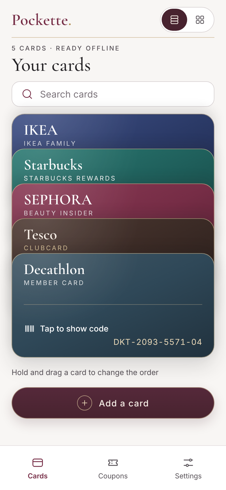
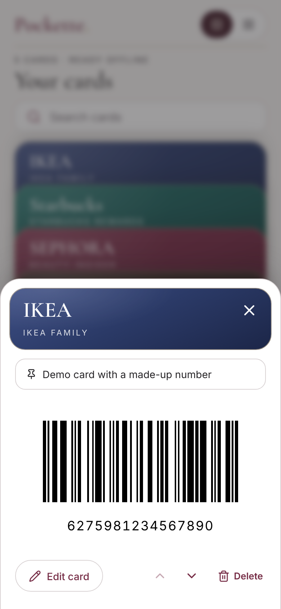
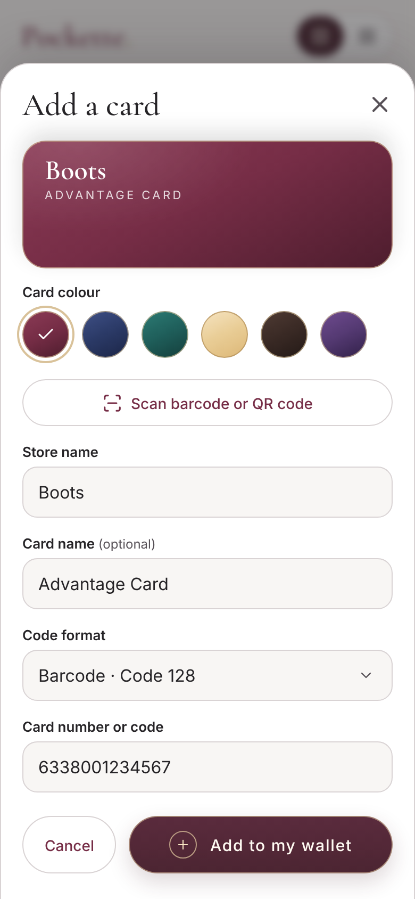
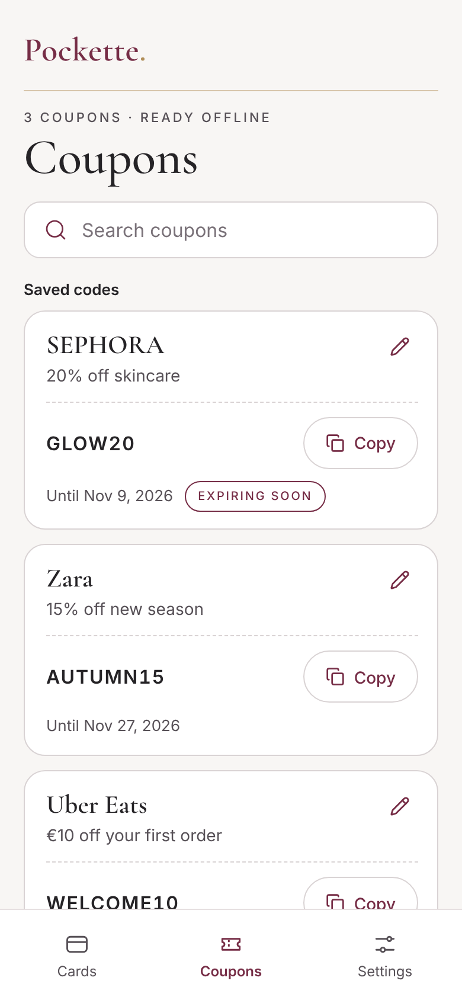
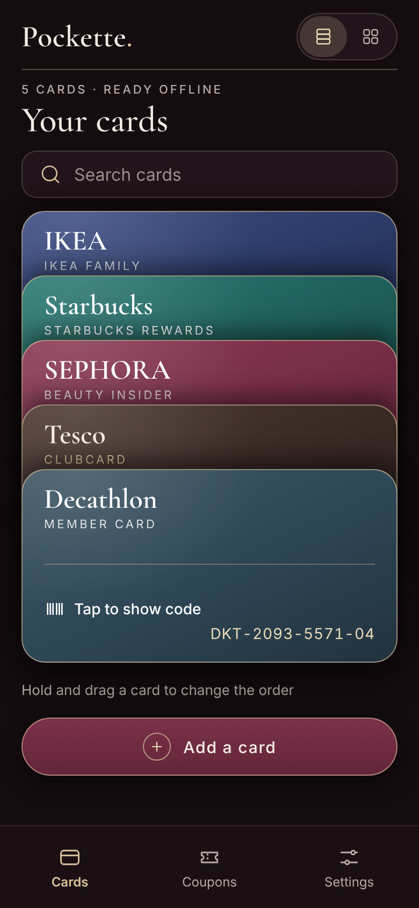
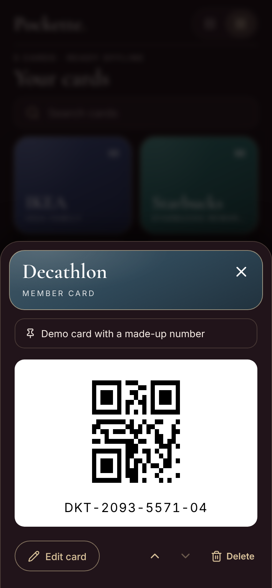
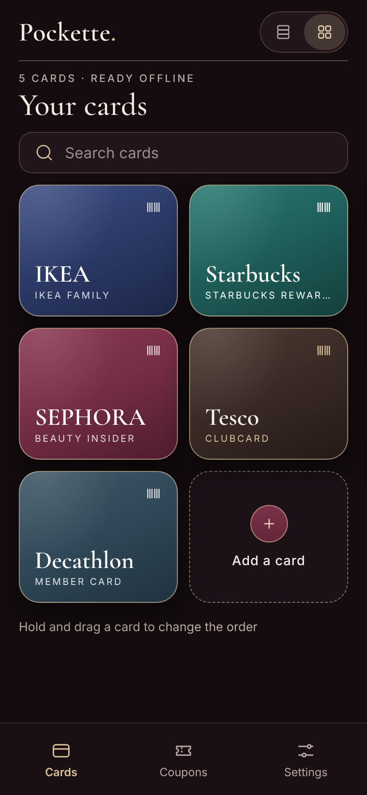
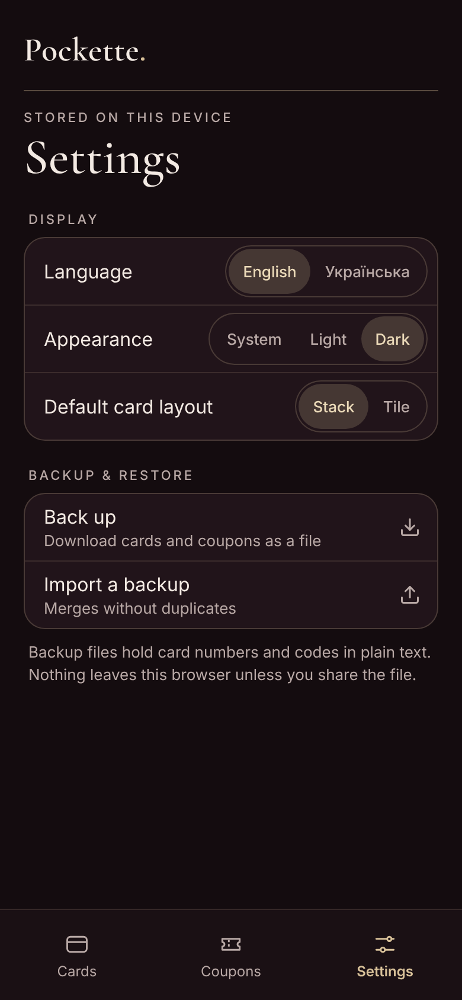

# Pockette

**Loyalty cards and promo codes, ready at checkout.**

Pockette is a mobile-first wallet for the moment you’re asked for a loyalty card. Scan a card once, find it by store name, and tap to show the barcode or QR code. Keep coupons in the same place, ready to copy. After the first visit, the installed web app can open offline.

<p align="center">
  
  
  
  
</p>

<p align="center">
  
  
  
  
</p>

<p align="center"><em>Light and dark mode. Screenshots use demo cards. More screens, including the splash, search and Ukrainian, are in <a href="docs/screenshots/demo/">docs/screenshots/demo</a>.</em></p>

## The experience

- **Find the right card quickly.** Recognize stores in the overlapping stack, switch to tiles, or search by store or card name. Arrange cards by dragging or use the keyboard and card controls.
- **Add cards from what you have.** Scan a barcode or QR code with the camera, choose a photo, or enter the value manually. Review the result before saving.
- **Keep promo codes handy.** Save an offer and expiry date, see which codes expire soon, and copy a code with one tap.
- **Make it yours.** Choose light, dark, or system appearance and switch between English and Ukrainian. Export or import a wallet backup from Settings.

## Design decisions

The stack borrows the familiarity of a physical wallet: each store name stays visible, and the front card gives the checkout action a clear place. The compact header keeps cards close to the top of the screen. The reorder hint sits below the stack, leaving search and card selection as the first things you see.

Ivory, bordeaux, and champagne accents carry across both themes. Cormorant Garamond gives store names and headings character; Inter keeps controls easy to read. Touch feedback helps distinguish tapping from dragging, with reduced motion respected.

## Built with

**React · TypeScript · Vite · CSS · PWA**

ZXing decodes images and camera frames on the device. bwip-js draws Code 128, EAN-13, EAN-8, UPC-A, Code 39, and QR codes. The service worker caches the app, fonts, and code tools for offline use. Cards and coupons are stored in the browser without an account or backend.

## Run locally

Use Node.js 20.19+ or 22.12+.

```sh
npm ci
npm run dev
```

Open [localhost:5173](http://localhost:5173/). To try the production build and offline support:

```sh
npm run build
npm run preview
```

Open [localhost:4173](http://localhost:4173/), let the app load once, then try it offline. For testing on a phone over Wi-Fi, `npm run phone` serves a local HTTPS preview; camera access requires a secure browser context.

## Testing and limits

With the production build ready and the preview server stopped, run:

```sh
npx playwright install chromium
npm test
```

The Playwright suite covers card creation and editing, reordering, code rendering, photo scanning and simulated camera input, offline reload, backup import, and coupon persistence. Physical checkout scanners still need testing.

Wallet data belongs to the browser profile and address you use. Clearing site data removes the wallet, so export a backup first. Backup files contain code values in plain text.
