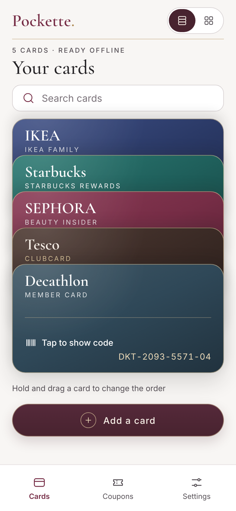
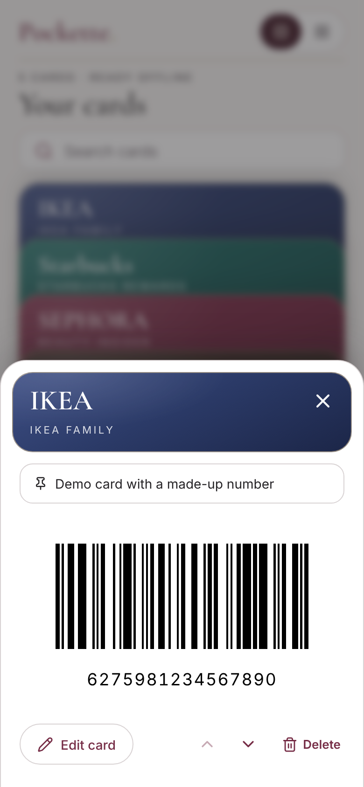
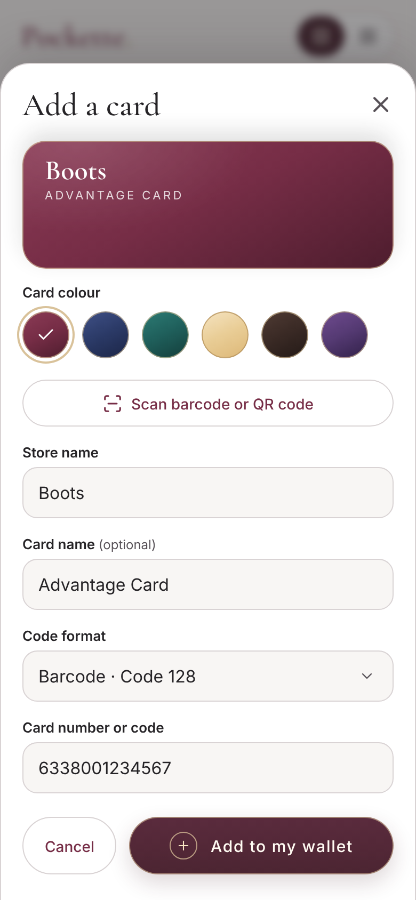
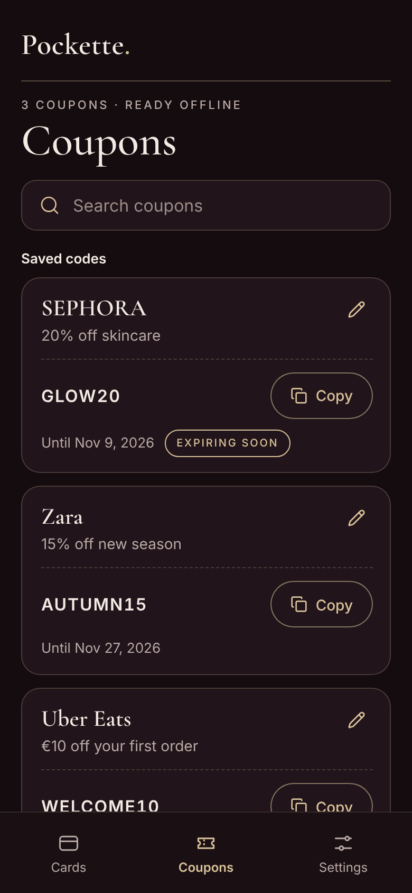

# Demo screens

Phone screens of Pockette for demos and presentations: 390 × 844 at 2× (780 × 1688 PNG), each in light and dark. They use made-up demo cards and coupons.

| # | Screen | Light | Dark |
|---|---|---|---|
| 01 | Launch splash | [light](01-splash-light.png) | [dark](01-splash-dark.png) |
| 02 | Wallet, card stack | [light](02-wallet-stack-light.png) | [dark](02-wallet-stack-dark.png) |
| 03 | Wallet, tiles | [light](03-wallet-tiles-light.png) | [dark](03-wallet-tiles-dark.png) |
| 04 | Card opened, barcode | [light](04-card-barcode-light.png) | [dark](04-card-barcode-dark.png) |
| 04b | Card opened, QR code | [light](04b-card-qr-light.png) | [dark](04b-card-qr-dark.png) |
| 05 | Search | [light](05-search-light.png) | [dark](05-search-dark.png) |
| 06 | Add a card: scan or enter | [light](06-add-card-light.png) | [dark](06-add-card-dark.png) |
| 07 | Add a card: manual entry | [light](07-add-card-manual-light.png) | [dark](07-add-card-manual-dark.png) |
| 08 | Coupons | [light](08-coupons-light.png) | [dark](08-coupons-dark.png) |
| 09 | Settings | [light](09-settings-light.png) | [dark](09-settings-dark.png) |
| 10 | Wallet in Ukrainian | [light](10-wallet-uk-light.png) | [dark](10-wallet-uk-dark.png) |

<p>
  
  
  
  
</p>

## Regenerate

After a UI change, rebuild and capture again. Coupon expiry dates are relative to the day you run it, so “Expiring soon” always shows.

```sh
npm run build
npm run screens
```

If Playwright can’t find its browser, point it at a local Chromium with `CHROMIUM_PATH=/path/to/chrome npm run screens`.
